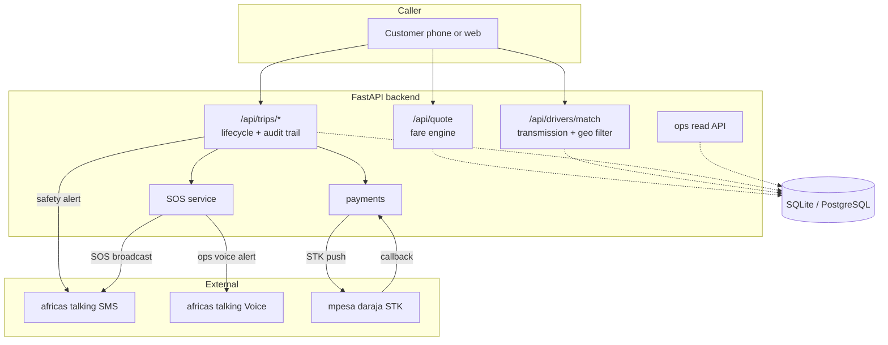
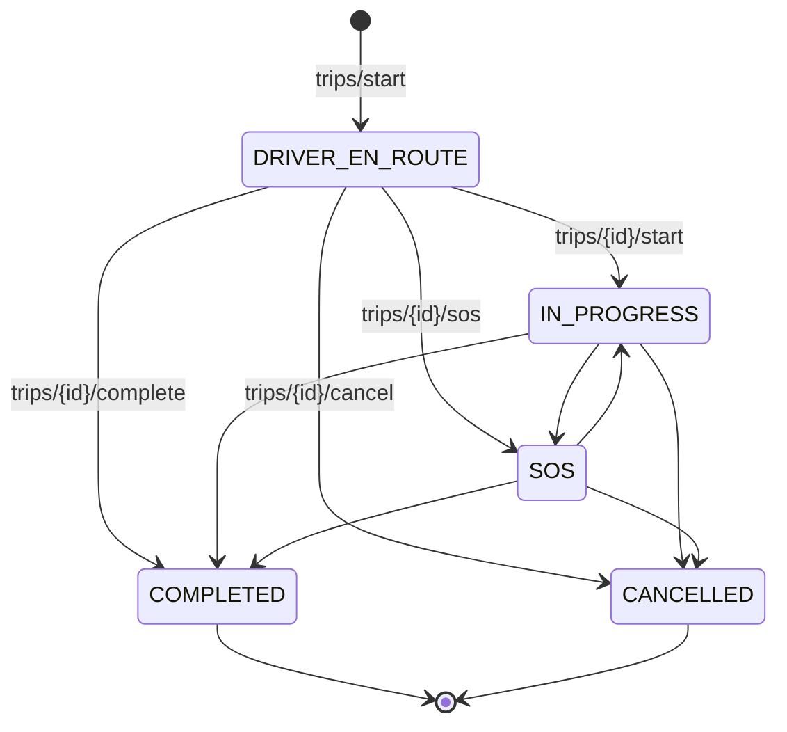

# iFinder — Dial-a-Driver for Kenya

**iFinder connects intoxicated, fatigued, or unwell car owners with verified professional chauffeurs who drive them home in their own vehicles.**

Powered by **Africa's Talking SMS & Voice APIs** — every trip sends a live safety alert to a trusted contact, and a one-tap SOS broadcasts to family plus ops support by SMS *and* voice.

> Built as a hackathon MVP. REST-only API: no mobile app, no customer install. Works from any device that can call an HTTP endpoint.

---

## Table of contents

- [Why this exists](#why-this-exists)
- [Architecture](#architecture)
- [Quick start](#quick-start)
- [API reference](#api-reference)
- [Africa's Talking integration](#africas-talking-integration)
- [Trip lifecycle](#trip-lifecycle)
- [Driver vetting rules](#driver-vetting-rules)
- [Going live checklist](#going-live-checklist)
- [Project layout](#project-layout)
- [Testing](#testing)

---

## Why this exists

Drink-driving is the leading cause of road fatalities in Kenya. The alternative most people have is *"leave the car and take a boda"* — which means an empty car overnight in Westlands, and an anxious trip back in the morning.

iFinder solves that: a vetted professional drives **your** car **you** home. The product lives or dies on **trust**, so the MVP is built around three guarantees:

1. **Verified drivers only** — DCI good-conduct certificate + NTSA licence, enforced in code (`dci_good_conduct_verified` is a hard filter on matching).
2. **Someone always knows where you are** — an SMS safety alert lands on your emergency contact the moment the trip starts, with driver name, licence number, plate, destination and a tracking link.
3. **A real emergency path** — SOS fans out to your contact *and* ops support via SMS, plus an Africa's Talking voice call so a human actually hears it.

### Transmission matching is the quiet killer feature

A driver certified only on automatics **cannot** drive your manual car. Getting this wrong strands the customer at the kerb at 2am. Every driver carries a `transmission_certified` value:

| Driver certification | Can drive MANUAL car | Can drive AUTOMATIC car |
|---|:---:|:---:|
| `MANUAL_AND_AUTO` | ✅ | ✅ |
| `AUTO_ONLY` | ❌ | ✅ |

The rule is enforced in three places — matching, trip start, and manual ops assignment — so a manual car can never be assigned an auto-only driver.

---

## Architecture



Every state change appends a `TripEvent` row. Nothing about a trip is inferred from mutable columns alone — the audit trail is the source of truth for what happened and when.

---

## Quick start

### Option A — local

```bash
python3 -m venv .venv
./.venv/bin/pip install -r requirements.txt

cp .env.example .env          # defaults are safe: no real SMS, no real money
./.venv/bin/python -m app.seed

./.venv/bin/uvicorn app.main:app --reload
```

Open **http://localhost:8000/docs** for interactive Swagger docs.

With `AT_ENABLED=false` and `MPESA_ENABLED=false`, SMS and STK Push are **simulated** — messages print to the server log and are persisted to the `sms_logs` table, so the whole demo works with zero credentials and zero cost.

### Option B — Docker

```bash
cp .env.example .env
docker compose up --build
```

---

## API reference

Base URL: `http://localhost:8000/api`

### `POST /api/quote` — fare quote

```bash
curl -X POST localhost:8000/api/quote -H 'Content-Type: application/json' -d '{
  "pickup":  {"address":"The Alchemist Bar, Parklands Rd, Nairobi","lat":-1.2642,"lng":36.8045},
  "dropoff": {"address":"Argwings Kodhek Rd, Kilimani, Nairobi","lat":-1.2974,"lng":36.7865},
  "distance_km": 8.5,
  "car_transmission": "AUTOMATIC"
}'
```

```json
{
  "currency": "KES",
  "distance_km": 8.5,
  "base_fare": 300.0,
  "per_km_rate": 65.0,
  "estimated_fare": 852.5,
  "estimated_duration_min": 24,
  "quote_expires_in_sec": 300
}
```

Pricing is `300 + 65 × km`. Duration assumes Nairobi traffic at ~21 km/h. Both are configurable via `FARE_BASE`, `FARE_PER_KM` and `AVG_SPEED_KMH`.

### `POST /api/drivers/match` — find a qualified driver

```bash
curl -X POST localhost:8000/api/drivers/match -H 'Content-Type: application/json' -d '{
  "car_transmission": "MANUAL",
  "pickup_lat": -1.2642,
  "pickup_lng": 36.8045,
  "radius_km": 5.0
}'
```

Returns the **nearest** driver who is simultaneously: `AVAILABLE`, **DCI-verified**, and **certification-compatible** with the car. `404` if nobody qualifies.

### `POST /api/trips/start` — begin a trip (fires the safety SMS)

```bash
curl -X POST localhost:8000/api/trips/start -H 'Content-Type: application/json' -d '{
  "user_name": "Caroline",
  "user_phone": "+254700000001",
  "car_details": {
    "make_model": "Subaru Impreza",
    "registration_plate": "KDA 829X",
    "transmission": "MANUAL"
  },
  "driver_id": "drv-94D5",
  "pickup_address": "The Alchemist Bar, Westlands",
  "pickup_lat": -1.2642, "pickup_lng": 36.8045,
  "dropoff_address": "Kilimani, Nairobi",
  "dropoff_lat": -1.2974, "dropoff_lng": 36.7865,
  "distance_km": 8.5,
  "emergency_contact": {"name": "Grace (Sister)", "phone": "+254711223344"}
}'
```

Response `201`:

```json
{
  "trip_id": "TRP-8F6E80",
  "status": "DRIVER_EN_ROUTE",
  "driver": { "name": "David Kamau", "phone": "+254712345678", "eta_minutes": 1 },
  "at_sms_dispatch": {
    "sent": true,
    "recipient": "+254711223344",
    "message_id": "ATXid_7701fae9",
    "cost": "KES 0.80"
  },
  "created_at": "2026-10-29T11:11:46.452814Z"
}
```

Side effects: driver → `ON_TRIP`, safety SMS sent and logged, `TRIP_CREATED` + `SAFETY_SMS_DISPATCHED` events written.
Returns `409` if the driver is unverified, busy, or certification-incompatible with the car.

### `POST /api/trips/{id}/start` — driver arrived, ride underway

`DRIVER_EN_ROUTE → IN_PROGRESS`.

### `POST /api/trips/{id}/sos` — emergency broadcast

```bash
curl -X POST localhost:8000/api/trips/TRP-8F6E80/sos -H 'Content-Type: application/json' -d '{
  "current_lat": -1.2789,
  "current_lng": 36.7921,
  "trigger_reason": "PASSENGER_TRIGGERED_SOS"
}'
```

```json
{
  "status": "EMERGENCY_BROADCAST_SENT",
  "timestamp": "2026-10-29T11:11:46.603447Z",
  "sms_dispatched_to": ["+254711223344", "+254700000999"],
  "at_voice_alert_queued": true,
  "incident_ticket_id": "SOS-8E012"
}
```

Fans out to the emergency contact **and** ops support by SMS, plus an Africa's Talking **voice call** to ops. Creates a `SosIncident` and moves the trip to `SOS` (from which it can still be completed or cancelled).

### `POST /api/trips/{id}/complete` — checkout

```bash
curl -X POST localhost:8000/api/trips/TRP-8F6E80/complete \
  -H 'Content-Type: application/json' \
  -d '{"payment_method":"MPESA_STK_PUSH"}'
```

Computes the final fare, frees the driver, increments their trip count, and — for M-Pesa — fires an STK Push to the customer's phone. Returns `payment_options: ["MPESA_STK_PUSH", "CASH"]`.

### `POST /api/trips/{id}/rate`

```bash
curl -X POST localhost:8000/api/trips/TRP-8F6E80/rate -H 'Content-Type: application/json' -d '{
  "rating": 5,
  "tags": ["Punctual","Smooth Driver","Careful with Vehicle"],
  "feedback_comment": "David arrived in 5 minutes and drove my manual car very smoothly."
}'
```

Only completed trips, one rating per trip. The driver's running average is recomputed from `rating_sum / rating_count` so ratings stay correct under concurrency.

### Ops endpoints

| Method | Path | Purpose |
|---|---|---|
| `GET` | `/api/health` | Liveness + DB + integration status |
| `GET` | `/api/trips` | Recent trips |
| `GET` | `/api/trips/{id}` | Full detail: events + SMS logs |
| `GET` | `/api/sms-logs` | Every SMS with provider id, cost, status |
| `GET` | `/api/drivers` | Driver roster |
| `POST` | `/api/drivers` | Onboard a driver |
| `POST` | `/api/trips/{id}/cancel` | Cancel a trip |
| `POST` | `/api/trips/{id}/pay/cash` | Confirm cash collected |
| `POST` | `/api/mpesa/callback` | Daraja payment webhook |

Interactive docs: **`/docs`**.

---

## Africa's Talking integration

Two services, both wrapped in [`app/services/africastalking.py`](app/services/africastalking.py).

### SMS

`sms_client.send(message, recipients)` posts to the AT messaging endpoint with an `apiKey` header, then parses `SMSMessageData.Recipients[]` for per-recipient `messageId`, `cost` and `statusCode`. Every call is persisted to `sms_logs` **whether or not it succeeded** — failures are recorded with the provider error, never silently swallowed.

Safety SMS dispatched on trip start:

> iFinder Safety Alert: Caroline has started a trip in her Subaru Impreza (KDA 829X) with certified driver David Kamau (DL: DL-KE-488219). Destination: Kilimani, Nairobi. Live tracking: https://ifinder.app/track/TRP-8F6E80

### Voice

`voice_client.call(recipients)` posts to the AT voice endpoint for the SOS ops alert, so an emergency produces a ringing phone, not just an unread text.

### Credentials

```bash
AT_ENABLED=true
AT_USERNAME=your_app_username      # not "sandbox" in production
AT_API_KEY=atsk_...
AT_SENDER_ID=iFinder               # shortcode or alphanumeric sender, must be approved
```

**Leaving `AT_ENABLED=false`** uses a console sender: messages log to stderr with `[AT disabled]` and land in `sms_logs` with `provider="console"`. The full flow is demoable and testable with no account.

### Cost control

SMS is billed per message. The MVP sends **one** SMS per trip start, **two** on SOS, and **one** per payment result. `sms_logs.dedupe_key` makes dispatches idempotent — a retried trip start cannot double-bill or double-notify.

---

## Trip lifecycle



Illegal transitions return **409**, never a silent state corruption. The allowed-edge map lives in [`ALLOWED_TRANSITIONS`](app/services/trips.py:36).

`DRIVER_EN_ROUTE → COMPLETED` is deliberately permitted so ops can close out a short hop the driver never explicitly started.

---

## Driver vetting rules

Enforced in code, not by process:

- `dci_good_conduct_verified == True` — **hard filter** on matching and on trip start.
- `ntsa_license_no` — required for the safety SMS so the contact can verify the driver.
- `transmission_certified` — must cover the customer's car.
- `status == AVAILABLE` — not `ON_TRIP`, `OFFLINE`, or `SUSPENDED`.

The seed data includes **Samuel Kiprop**, an unverified driver parked closest to the demo pickup. He exists to prove the filter works — he never appears in a match.

### Before real customers

- [ ] Signed driver agreement + background checks on file
- [ ] **Commercial insurance arrangement covering a third-party driver in the customer's vehicle** ← the single biggest business risk
- [ ] Incident response playbook for SOS events, with an on-call number that a human answers
- [ ] Data protection: DPIA under the Kenya Data Protection Act, 2019; restrict driver PII access
- [ ] Rate limiting on `/api/trips/start` and SMS spend caps in the AT dashboard

---

## Going live checklist

**Africa's Talking** (start early — approval takes days)
- [ ] Create a live app, get `username` + `apiKey`
- [ ] Apply for and get approval on an alphanumeric sender ID or shortcode
- [ ] Fund the account; set a spend cap
- [ ] Whitelist your server IP if IP restrictions are enabled

**M-Pesa Daraja**
- [ ] Register on the Daraja portal, get consumer key/secret
- [ ] Obtain a paybill or till number, plus the passkey
- [ ] Set `MPESA_CALLBACK_URL` to a **public HTTPS** URL — Daraja cannot reach localhost
- [ ] Handle the sandbox → production base URL switch (`MPESA_ENV=production`)

**Webhook testing**

```bash
ngrok http 8000
# then set MPESA_CALLBACK_URL=https://<id>.ngrok.app/api/mpesa/callback
```

**Infrastructure**
- [ ] Swap `DATABASE_URL` to PostgreSQL (`postgresql+psycopg://...`)
- [ ] Move `create_all` to Alembic migrations
- [ ] Add an ops auth layer — **the ops endpoints are currently unauthenticated**
- [ ] Structured logs to a collector; alert on SOS volume and SMS failure rate

---

## Project layout

```
app/
  main.py                  FastAPI app factory, router wiring, lifespan
  config.py                pydantic-settings configuration
  database.py              engine, session, get_db dependency
  models.py                ORM: Driver, Trip, TripEvent, SmsLog, VoiceLog, SosIncident, Rating
  schemas.py               request/response contracts, KE phone normalisation, UTC serialiser
  seed.py                  demo drivers (idempotent)
  api/
    routes_quote.py        /api/quote
    routes_drivers.py      /api/drivers/match + driver CRUD
    routes_trips.py        start, begin, sos, complete, rate, cancel
    routes_mpesa.py        /api/mpesa/callback, cash confirmation
    routes_ops.py          trip list/detail, sms logs
    routes_health.py       /api/health
  services/
    fare.py                300 + 65/km pricing
    geo.py                 haversine, ETA, distance resolution
    matching.py            certification + proximity + verification filters
    trips.py               lifecycle, transitions, audit trail
    sos.py                 emergency fan-out
    ratings.py             rating + cumulative average
    notifications.py       SMS copy
    africastalking.py      SMS + Voice clients, console fallback
    mpesa.py               Daraja STK Push, simulated when disabled
tests/                     48 tests, AT + Daraja mocked
```

---

## Testing

```bash
./.venv/bin/python -m pytest
```

**48 tests, all passing.** Every test runs against a real SQLite database with Africa's Talking and Daraja mocked — no network, no cost, no flakiness.

Coverage highlights:

- **Pricing** — the spec's 8.5 km → 852.5 KES example, scaling, zero/negative rejection
- **Matching** — manual vs auto rules, unverified drivers excluded, radius exclusion, response shape
- **Trip lifecycle** — start/begin/complete/cancel, illegal transitions → 409, driver freed on completion, full audit-trail ordering
- **SOS** — fan-out to contact + ops, voice queued, rejected after completion, coordinates in message body
- **Payments** — success and cancellation callbacks, unknown checkout acknowledged (Daraja retries on non-200), cash path
- **Ratings** — average recomputation, one-per-trip, range validation
- **Edge cases** — Kenyan phone normalisation (`0700...` → `+254700...`), UTC `Z` serialisation, ETA derived from real distance

---

## Demo script (3 minutes)

```bash
cp .env.example .env && ./.venv/bin/python -m app.seed
./.venv/bin/uvicorn app.main:app --reload
```

1. **Quote** — "8.5 km from Westlands to Kilimani, KES 852.50."
2. **Match a MANUAL car** — returns David (`MANUAL_AND_AUTO`). Note Samuel, the closer unverified driver, is *not* returned.
3. **Match an AUTOMATIC car** — returns Faith (`AUTO_ONLY`). Different driver, same endpoint.
4. **Start the trip** — watch the server log: the safety SMS to Grace prints in full.
5. **`GET /api/trips/{id}`** — open the audit trail and the SMS log.
6. **SOS** — two SMS recipients plus a voice alert queued.
7. **Complete + M-Pesa callback** — payment flips to `PAID`, receipt SMS logged.
8. **Rate** — 5 stars, `new_driver_average_rating: 4.92`.

**The story to tell:** the safety SMS and the SOS broadcast are the product. The fare engine is table stakes; the reason a parent lets their daughter use this is that they get a text with the driver's name, licence number and plate before the car moves.
